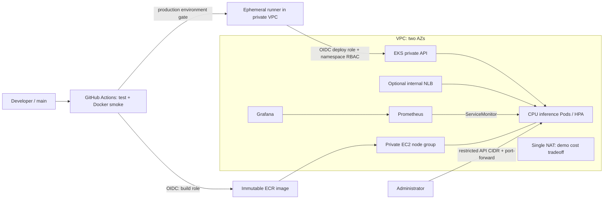

# Hugging Face → AWS EKS | DevOps portfolio

Практический проект: небольшой inference API, воспроизводимая AWS-инфраструктура,
CI/CD без постоянных AWS keys и наблюдаемость. Документация на русском, имена и код на английском.
**Статус:** шаблон для самостоятельного запуска; AWS deploy и live inference не заявляются как выполненные.
Результаты доступных локальных проверок находятся в [VALIDATION.md](docs/VALIDATION.md).

Модель: [DistilBERT SST-2](https://huggingface.co/distilbert/distilbert-base-uncased-finetuned-sst-2-english),
около 67 млн параметров, Apache-2.0. Анализ тональности **английского** текста, POSITIVE/NEGATIVE.
Это учебная модель с ограничениями и смещениями из model card, не универсальный классификатор.
Revision закреплён полным commit SHA в `scripts/download_model.py`; используются safetensors,
`trust_remote_code=False`. Веса попадают в образ во время build, runtime offline.



Две CPU-ноды `t3.large`, две private subnet и public subnet с NAT. Control plane управляется AWS.
Один NAT снижает расходы учебного стенда, но создаёт единую точку отказа egress и межзональный трафик.
Приложение: 2–4 pod, 500m CPU request, 1 CPU limit, bounded inference queue и один worker на pod.
HPA использует Metrics Server add-on. **HPA не добавляет EC2-ноды**: max_size группы сам по себе
не включает autoscaling. Для перегрузки предусмотрен 429; свободную capacity проверяйте отдельно.

## Что внутри

- `app/`, `tests/`, `Dockerfile`: JSON API, probes, Prometheus metrics, unit tests и real-model smoke в CI.
- `terraform/`: VPC, EKS + managed addons, ECR, GitHub OIDC, разделённые build/deploy IAM roles.
- `k8s/`: Deployment, Service, HPA, PDB, restricted namespace, ограниченный deploy Role.
- `monitoring/`: Helm values, ServiceMonitor, alert rules и Grafana dashboard.
- `.github/workflows/ci-cd.yaml`: PR checks → main build/smoke/push → gated deploy по digest.
- `examples/gpu/`: отдельный opt-in GPU node group и CUDA workload.

## Prerequisites

AWS sandbox account с billing access и квотами EKS, EC2, Elastic IP, NAT; AWS CLI v2,
Terraform >=1.10 <2, Docker с linux/amd64 build, Python 3.12, kubectl 1.35, Helm 3, Git, OpenSSL.
Region по умолчанию `us-west-2`; EKS version 1.35. Перед apply проверьте доступность версии,
AMI/addons и standard support в выбранном регионе.
Нужна существующая IAM admin role для bootstrap (не ARN временной STS-сессии).
Terraform выполняется человеком под role с правами создавать перечисленные ресурсы и IAM/pass-role.
CI **не** получает Terraform/admin credentials. Войдите через AWS SSO/временные credentials.

## 1. Проверить API локально

```bash
python3.12 -m venv .venv
source .venv/bin/activate
pip install -r requirements-dev.txt
python -m pytest -q
ruff check app tests scripts/download_model.py

docker build --platform linux/amd64 -t hf-inference:local .
docker run --rm --name hf-inference --read-only --tmpfs /tmp:rw,size=128m   -p 127.0.0.1:8000:8000 hf-inference:local
# В другом терминале после готовности:
bash scripts/smoke.sh
```

Первый build скачивает PyTorch и веса; нужен интернет и несколько GB свободного диска.
Unit tests подменяют модель: настоящий download/inference проверяет Docker smoke, отдельно от них.
Не запускайте `uvicorn` на хосте без загруженной модели: `/opt/model` создаётся в Docker build.

```bash
curl -fsS http://127.0.0.1:8000/predict -H 'Content-Type: application/json'   -d '{"text":"This product is excellent"}'
# {"label":"POSITIVE","score":...}
```

`GET /health/live`, `GET /health/ready`, `GET /metrics/`, `POST /predict`.
Длина текста 1–2000 символов; токенизация обрезает вход до 256 токенов.
До восьми выполняемых/ожидающих запросов на pod, далее 429. Inference вынесен в отдельный поток,
чтобы очередь модели не блокировала probes. Текст не записывается в application/access logs.
Нет аутентификации, TLS и rate limit на периметре: базовый Service доступен только внутри кластера.

## 2. Создать AWS-инфраструктуру

```bash
aws sso login --profile YOUR_PROFILE
export AWS_PROFILE=YOUR_PROFILE
aws sts get-caller-identity
cp terraform/terraform.tfvars.example terraform/terraform.tfvars
# Отредактируйте repository, admin_role_arn и свой реальный public IP/32.
terraform -chdir=terraform init
terraform -chdir=terraform fmt -check -recursive
terraform -chdir=terraform validate
terraform -chdir=terraform plan -out=demo.tfplan
terraform -chdir=terraform apply demo.tfplan
export AWS_REGION=$(terraform -chdir=terraform output -raw region)
export CLUSTER_NAME=$(terraform -chdir=terraform output -raw cluster_name)
export ECR_URL=$(terraform -chdir=terraform output -raw ecr_url)
aws eks update-kubeconfig --region "$AWS_REGION" --name "$CLUSTER_NAME"   --role-arn YOUR_ADMIN_ROLE_ARN
kubectl get nodes
kubectl top nodes
```

`YOUR_ADMIN_ROLE_ARN` — та же role, что в tfvars; вызывающий principal должен иметь sts:AssumeRole.
Если уже работаете именно под этой role, `--role-arn` можно опустить.
GitHub OIDC provider единственный на аккаунт/URL: передайте `github_oidc_provider_arn`, если он уже есть.
Без этого Terraform пытается создать новый provider.
Terraform state хранит инфраструктурные данные и не должен попадать в Git. Для personal demo используется
локальный state; сделайте защищённую резервную копию до cleanup. Для команды используйте S3 backend:
[отдельная настройка](docs/SECURITY.md), шифрование, versioning и locking.
`.terraform.lock.hcl` включён в поставку; проверяйте изменения lock file при обновлении зависимостей.

## 3. Первая публикация образа и bootstrap

```bash
aws ecr get-login-password --region "$AWS_REGION" |   docker login --username AWS --password-stdin "${ECR_URL%%/*}"
TAG="sha-bootstrap-$(date -u +%Y%m%d%H%M%S)"
docker build --platform linux/amd64 -t "$ECR_URL:$TAG" .
docker push "$ECR_URL:$TAG"
DIGEST=$(aws ecr describe-images --region "$AWS_REGION"   --repository-name "${ECR_URL#*/}" --image-ids "imageTag=$TAG"   --query 'imageDetails[0].imageDigest' --output text)
export IMAGE="$ECR_URL@$DIGEST"
bash scripts/bootstrap-app.sh
bash scripts/install-monitoring.sh
kubectl -n inference get deployment,hpa,pdb,service
kubectl -n inference port-forward service/inference 8000:80
# В другом терминале:
bash scripts/smoke.sh
```

Образ разворачивается по digest. ECR immutable tags; повторная сборка использует новый tag.
Bootstrap от администратора создаёт namespace, RBAC и manifests. CI обновляет только image,
поэтому изменения YAML применяйте повторным bootstrap с проверенным IMAGE.
Повторный bootstrap временно возвращает replicas=2; HPA затем продолжает управлять масштабом.

## 4. Prometheus / Grafana

```bash
kubectl -n monitoring port-forward service/monitoring-grafana 3000:80
# Получить пароль в своей консоли (не добавлять в Git/скриншоты):
kubectl -n monitoring get secret grafana-admin   -o jsonpath='{.data.admin-password}' | base64 --decode
```

Откройте http://localhost:3000, login `admin`, dashboard **HF EKS Inference**.
Панели: RPS, P95 latency, errors, overload. Создайте трафик smoke-скриптом и подождите scrape/5m rate window.
Метрики latency включают очередь принятого запроса; validation errors 422 не входят в inference counter.
Alert rules доступны в Prometheus, Alertmanager/внешние уведомления не настроены.
Prometheus retention 6h/2GB, storage ephemeral; Grafana также ephemeral, dashboard provisioned ConfigMap.
При пересоздании monitoring pod история теряется. Для production нужны PVC/EBS CSI, backups,
TLS/auth, alert routing, SLO и load test. EKS audit logs сохраняются в CloudWatch 7 дней.

## 5. GitHub Actions: OIDC и deploy

Создайте собственный пустой GitHub repo и загрузите содержимое каталога (включая `.github/`).
Например, из корня распакованного проекта:

```bash
git init -b main
git add .
git commit -m "Add Hugging Face inference platform on AWS EKS"
git remote add origin https://github.com/KostanPROFF/hf-eks-portfolio.git
git push -u origin main
```

Сначала настройте variables/environment и runner, затем запускайте workflow.
До настройки AWS variables workflow выполняет только проверки: build/deploy пропускаются.
После настройки выполните Run workflow на main.
В repository Actions variables внесите значения из `terraform output`:

| Variable | Значение |
|---|---|
| `AWS_REGION` | `region` |
| `CLUSTER_NAME` | `cluster_name` |
| `ECR_URL` | `ecr_url` |
| `BUILD_ROLE_ARN` | `build_role_arn` |
| `DEPLOY_ROLE_ARN` | `deploy_role_arn` |

Создайте Environment `production`: required reviewers, разрешена только protected branch `main`.
Наличие required reviewers зависит от тарифа/visibility GitHub; настройте доступный вам gate до запуска.
OIDC build trust привязан к exact repo/main; deploy trust — exact repo/environment production.
Для environment subject ветка контролируется **GitHub Environment deployment branch rules**, не IAM sub.
Уберите право обходить reviewers там, где это доступно; защитите main и workflow-файлы review.
Статические AWS keys и HF token не нужны.

Deploy job рассчитан на **self-hosted ephemeral Linux x64 runner** с labels `self-hosted,linux,x64,eks-vpc`,
который вы регистрируете отдельно. Он не создаётся Terraform: регистрационный credential GitHub
намеренно не передаётся в state. Установите на runner AWS CLI v2, kubectl 1.35, bash, Git;
включите исходящий HTTPS к GitHub, AWS STS/EKS через NAT и DNS VPC.
Разместите runner в private subnet; разрешите его security group входящий TCP/443 в cluster primary SG.
Права инфраструктуры runner не должны включать EKS/ECR admin. Credentials приложение получает через OIDC job.
Используйте одноразовый runner, ограниченный этим private/trusted repo, и не допускайте PR jobs на него.
Для публичного repo используйте выделенный runner group с workflow restrictions либо изолированный
одноразовый runner и строгий review main. [Сетевая проверка и эксплуатация](docs/OPERATIONS.md).

PR запускает только тесты и validation на GitHub-hosted runner, без AWS credentials.
Push main: tests → real-model Docker smoke → ECR push → production gate → patch Deployment → wait rollout.
Если runner отсутствует, deploy job останется queued; сборка образа сама по себе не означает deploy.
AWS API endpoint ограничен admin CIDR; GitHub-hosted build к нему не подключается.
Deploy роль может только DescribeCluster и get/list/patch/watch одного Deployment; без Secrets/RBAC/admin прав.
Это доверенный CD principal: patch Deployment позволяет менять pod spec, потому main/workflow review обязателен.
CI не публикует Terraform и не выполняет terraform apply.

## 6. Внутренний LoadBalancer (опционально)

Сначала установите `enable_load_balancer_controller = true`, выполните Terraform plan/apply:

```bash
export VPC_ID=$(terraform -chdir=terraform output -raw vpc_id)
bash scripts/install-lb-controller.sh
# IMAGE должен оставаться проверенным ECR digest из шага 3.
OVERLAY=overlays/internal-nlb bash scripts/bootstrap-app.sh
kubectl -n inference get service inference -w
```

Используется AWS Load Balancer Controller 2.13.3, EKS Pod Identity и versioned upstream IAM policy.
NLB internal, IP targets, source range VPC CIDR. HTTP доступен лишь из связанной сети VPC/VPN;
для публичной демонстрации используйте port-forward. Это не TLS endpoint.
Не меняйте class/scheme существующего LB на месте: удалите Service, дождитесь удаления AWS LB и создайте заново.
Базовый ClusterIP можно заменить этим overlay; возврат с LB делайте также через удаление Service.
Не удаляйте controller/IAM до удаления NLB: finalizer нужен для освобождения AWS ресурсов.

## Стоимость и ограничения

Оценка для us-west-2, USD, 730 часов/месяц, без налогов/кредитов/скидок; это бюджет стенда,
а не актуальная коммерческая котировка. EKS standard support: $0.10/час ≈ **$73/месяц**;
extended support $0.60/час ≈ $438. Проверено по [AWS EKS pricing](https://aws.amazon.com/eks/pricing/).
[Срок поддержки версий](https://docs.aws.amazon.com/eks/latest/userguide/kubernetes-versions.html).

| Компонент | Ориентир бюджета / месяц |
|---|---:|
| EKS standard control plane | $73 |
| 2 × t3.large On-Demand | $120–150 |
| Один NAT + его public IPv4, без трафика | $35–45 |
| Диски нод, ECR, CloudWatch | $10–30 |
| Базовый стенд суммарно | **примерно $240–300** |
| Optional NLB, плюс capacity/traffic | ещё $17–30+ |
| Optional g4dn.xlarge, 24/7 | ещё $380–500+ |
| Отдельный CI runner | отдельно, зависит от размещения |

Диапазоны для EC2/NAT/storage — плановые допущения, не выгруженные тарифы.
До apply пересчитайте выбранные instance type/region/GB в [AWS Pricing Calculator](https://calculator.aws/).
Дополнительно: NAT processing, egress, cross-AZ data, ECR transfer/storage, public IPv4, T3 surplus credits,
CloudWatch ingestion и стоимость runner. На малом трафике T3 burstable подходит демонстрации,
при постоянном CPU inference сравните M/C instances. Поставьте AWS Budget alert заранее.
Не обещайте SLA/latency и экономию без измерений. Terraform destroy удаляет стенд, остановка pod не останавливает биллинг EKS/NAT.

## Cleanup — порядок важен

Остановите/отключите workflow и runner, сохраните доказательства, если нужны для портфолио.
Сначала удалите Kubernetes-ресурсы с AWS finalizers, пока cluster/controller/IAM работают:

```bash
kubectl -n inference delete service inference --ignore-not-found
# Если был NLB: дождитесь его удаления в AWS EC2 Load Balancers и связанных target groups/ENI.
kubectl delete namespace inference --ignore-not-found
helm uninstall monitoring -n monitoring
kubectl delete namespace monitoring --ignore-not-found
# Если был установлен:
helm uninstall aws-load-balancer-controller -n kube-system
# Если был GPU plugin:
helm uninstall nvdp -n gpu-system
kubectl delete namespace gpu-system --ignore-not-found
```

Команды `helm uninstall` для неустановленных releases пропустите. Удаление monitoring namespace удалит
его secrets/data; CRD Helm может сохранить до удаления EKS, что нормально для disposable cluster.
ECR защищён `force_delete=false`: сначала осознанно очистите **только repository этого стенда**,
после остановки CI. Команды ниже необратимо удаляют его образы:

```bash
export ECR_REPOSITORY="${ECR_URL#*/}"
aws ecr list-images --region "$AWS_REGION" --repository-name "$ECR_REPOSITORY"   --query 'imageIds' --output json > /tmp/hf-eks-image-ids.json
# Для небольшого demo repo (<100 image IDs); при большем количестве удаляйте batches <=100.
# Если JSON пустой [], batch-delete пропустите.
aws ecr batch-delete-image --region "$AWS_REGION" --repository-name "$ECR_REPOSITORY"   --image-ids file:///tmp/hf-eks-image-ids.json
terraform -chdir=terraform plan -destroy -out=cleanup.tfplan
terraform -chdir=terraform apply cleanup.tfplan
```

Проверьте EC2 instances, NAT Gateway/EIP, NLB/target groups, ECR, CloudWatch log groups и volumes по Project tag.
Удалите отдельно созданный runner, его регистрацию, и при необходимости внешние backend bucket/state backups
только после успешного destroy. Existing GitHub OIDC provider переданный ARN не удаляется этим проектом.
Если controller finalizer завис, восстановите controller/IAM и проверьте логи; не снимайте finalizer вслепую.

## Как представить в портфолио

Добавьте собственные скриншоты успешного GitHub Actions run, `kubectl get pods/hpa`, Grafana и JSON prediction.
Сохраните дату, region, image digest, число запросов и измеренные latency/RPS. Результаты не включены
автоматически: этот репозиторий не доказывает выполненный AWS deploy.

После реального запуска можно использовать формулировку в резюме:
«Развернул CPU inference API Hugging Face на AWS EKS; описал VPC/EKS/ECR в Terraform,
настроил GitHub Actions с OIDC и разделением IAM/RBAC, HPA и мониторинг Prometheus/Grafana».
Указывайте реальные метрики и расходы; не добавляйте production experience/SLA без оснований.

## Источники и обновления

- [EKS access entries](https://docs.aws.amazon.com/eks/latest/userguide/access-entries.html)
- [EKS network load balancing](https://docs.aws.amazon.com/eks/latest/userguide/network-load-balancing.html)
- [EKS module 21.26.0](https://registry.terraform.io/modules/terraform-aws-modules/eks/aws/21.26.0)
- [GitHub OIDC on AWS](https://docs.github.com/en/actions/security-for-github-actions/security-hardening-your-deployments/configuring-openid-connect-in-amazon-web-services)
- [EKS Pod Identity](https://docs.aws.amazon.com/eks/latest/userguide/pod-identities.html)

Модули/charts/model revision закреплены. Actions закреплены commit SHA, Dependabot настроен для обновлений. Docker base tags требуют регулярного обновления;
для строгой supply chain закрепите проверенные base image digests, введите SBOM/signing и vulnerability gate.
ECR scan-on-push включён, но его наличие само по себе не блокирует deploy уязвимого образа.
Код проекта MIT; модель и сторонние компоненты сохраняют собственные лицензии.
