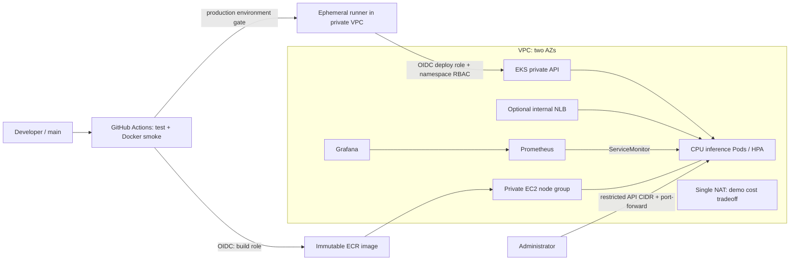

# Hugging Face → AWS EKS | DevOps portfolio

Hands-on project: a small inference API, reproducible AWS infrastructure,
CI/CD without long-lived AWS keys, and observability. Documentation is in English, names and code are in English.
**Status:** a template to run on your own; an AWS deploy and live inference are not claimed as completed.
The results of the available local checks are in [VALIDATION.md](docs/VALIDATION.md).

Model: [DistilBERT SST-2](https://huggingface.co/distilbert/distilbert-base-uncased-finetuned-sst-2-english),
about 67M parameters, Apache-2.0. Sentiment analysis of **English** text, POSITIVE/NEGATIVE.
This is an educational model with the limitations and biases listed in its model card, not a universal classifier.
The revision is pinned to a full commit SHA in `scripts/download_model.py`; safetensors are used,
`trust_remote_code=False`. The weights are baked into the image at build time; the runtime is offline.



Two CPU nodes `t3.large`, two private subnets, and a public subnet with a NAT gateway. The control plane is managed by AWS.
A single NAT lowers the cost of the lab, but creates a single point of failure for egress and cross-AZ traffic.
Application: 2–4 pods, 500m CPU request, 1 CPU limit, a bounded inference queue, and one worker per pod.
The HPA uses the Metrics Server add-on. **The HPA does not add EC2 nodes**: a node group's `max_size` alone does
not enable autoscaling. Overload returns 429; check the spare capacity separately.

## What's inside

- `app/`, `tests/`, `Dockerfile`: JSON API, probes, Prometheus metrics, unit tests, and a real-model smoke test in CI.
- `terraform/`: VPC, EKS + managed add-ons, ECR, GitHub OIDC, separated build/deploy IAM roles.
- `k8s/`: Deployment, Service, HPA, PDB, restricted namespace, and a scoped deploy Role.
- `monitoring/`: Helm values, ServiceMonitor, alert rules, and a Grafana dashboard.
- `.github/workflows/ci-cd.yaml`: PR checks → main build/smoke/push → digest-pinned gated deploy.
- `examples/gpu/`: a separate opt-in GPU node group and a CUDA workload.

## Prerequisites

An AWS sandbox account with billing access and EKS, EC2, Elastic IP, and NAT quotas; AWS CLI v2,
Terraform >=1.10 <2, Docker with linux/amd64 builds, Python 3.12, kubectl 1.35, Helm 3, Git, OpenSSL.
The default region is `us-west-2`; EKS version 1.35. Before applying, verify version availability,
AMI/add-ons, and standard support in the chosen region.
An existing IAM admin role is required for bootstrap (not the ARN of a temporary STS session).
Terraform is run by a human under a role allowed to create the listed resources and IAM/pass-role.
CI **does not** receive Terraform/admin credentials. Sign in via AWS SSO or temporary credentials.

## 1. Verify the API locally

```bash
python3.12 -m venv .venv
source .venv/bin/activate
pip install -r requirements-dev.txt
python -m pytest -q
ruff check app tests scripts/download_model.py

docker build --platform linux/amd64 -t hf-inference:local .
docker run --rm --name hf-inference --read-only --tmpfs /tmp:rw,size=128m   -p 127.0.0.1:8000:8000 hf-inference:local
# In another terminal, once the container is ready:
bash scripts/smoke.sh
```

The first build downloads PyTorch and the weights; it needs internet access and several GB of free disk space.
Unit tests stub the model: real download/inference is covered by the Docker smoke test, separately from them.
Do not run `uvicorn` on the host without a downloaded model: `/opt/model` is created during the Docker build.

```bash
curl -fsS http://127.0.0.1:8000/predict -H 'Content-Type: application/json'   -d '{"text":"This product is excellent"}'
# {"label":"POSITIVE","score":...}
```

`GET /health/live`, `GET /health/ready`, `GET /metrics/`, `POST /predict`.
Text length is 1–2000 characters; tokenization truncates the input to 256 tokens.
Up to eight in-flight/queued requests per pod; beyond that, 429. Inference runs in a separate thread
so that the model queue never blocks the probes. Text is not written to application/access logs.
There is no authentication, TLS, or perimeter rate limiting: the base Service is reachable only inside the cluster.

## 2. Create the AWS infrastructure

```bash
aws sso login --profile YOUR_PROFILE
export AWS_PROFILE=YOUR_PROFILE
aws sts get-caller-identity
cp terraform/terraform.tfvars.example terraform/terraform.tfvars
# Edit repository, admin_role_arn, and your real public IP/32.
terraform -chdir=terraform init
terraform -chdir=terraform fmt -check -recursive
terraform -chdir=terraform validate
terraform -chdir=terraform plan -out=demo.tfplan
terraform -chdir=terraform apply demo.tfplan
export AWS_REGION=$(terraform -chdir=terraform output -raw region)
export CLUSTER_NAME=$(terraform -chdir=terraform output -raw cluster_name)
export ECR_URL=$(terraform -chdir=terraform output -raw ecr_url)
aws eks update-kubeconfig --region "$AWS_REGION" --name "$CLUSTER_NAME"   --role-arn YOUR_ADMIN_ROLE_ARN
kubectl get nodes
kubectl top nodes
```

`YOUR_ADMIN_ROLE_ARN` is the same role as in tfvars; the calling principal must have sts:AssumeRole.
If you are already operating under that role, `--role-arn` can be omitted.
The GitHub OIDC provider is unique per account/URL: pass `github_oidc_provider_arn` if it already exists.
Otherwise Terraform tries to create a new provider.
Terraform state holds infrastructure data and must not be committed to Git. A personal demo uses local state;
make a protected backup before cleanup. A team should use an S3 backend:
[separate setup](docs/SECURITY.md), encryption, versioning, and locking.
`.terraform.lock.hcl` is shipped with the project; review lock file changes when updating dependencies.

## 3. First image publish and bootstrap

```bash
aws ecr get-login-password --region "$AWS_REGION" |   docker login --username AWS --password-stdin "${ECR_URL%%/*}"
TAG="sha-bootstrap-$(date -u +%Y%m%d%H%M%S)"
docker build --platform linux/amd64 -t "$ECR_URL:$TAG" .
docker push "$ECR_URL:$TAG"
DIGEST=$(aws ecr describe-images --region "$AWS_REGION"   --repository-name "${ECR_URL#*/}" --image-ids "imageTag=$TAG"   --query 'imageDetails[0].imageDigest' --output text)
export IMAGE="$ECR_URL@$DIGEST"
bash scripts/bootstrap-app.sh
bash scripts/install-monitoring.sh
kubectl -n inference get deployment,hpa,pdb,service
kubectl -n inference port-forward service/inference 8000:80
# In another terminal:
bash scripts/smoke.sh
```

The image is deployed by digest. ECR tags are immutable; a rebuild uses a new tag.
Bootstrap from an administrator creates the namespace, RBAC, and manifests. CI updates only the image,
so apply YAML changes by re-running bootstrap with a verified IMAGE.
A repeated bootstrap temporarily resets replicas to 2; the HPA then resumes managing scale.

## 4. Prometheus / Grafana

```bash
kubectl -n monitoring port-forward service/monitoring-grafana 3000:80
# Fetch the password in your own console (do not add it to Git/screenshots):
kubectl -n monitoring get secret grafana-admin   -o jsonpath='{.data.admin-password}' | base64 --decode
```

Open http://localhost:3000, log in as `admin`, and open the **HF EKS Inference** dashboard.
Panels: RPS, P95 latency, errors, overload. Generate traffic with the smoke script and wait for the scrape/5m rate window.
Latency metrics include the accepted-request queue time; validation errors (422) are not counted in the inference counter.
Alert rules are available in Prometheus; Alertmanager/external notifications are not configured.
Prometheus retention is 6h/2GB with ephemeral storage; Grafana is also ephemeral, with the dashboard provisioned via ConfigMap.
Recreating a monitoring pod loses the history. Production requires PVC/EBS CSI, backups,
TLS/auth, alert routing, SLOs, and load testing. EKS audit logs are kept in CloudWatch for 7 days.

## 5. GitHub Actions: OIDC and deploy

Create your own empty GitHub repo and upload the contents of this directory (including `.github/`).
For example, from the root of the unpacked project:

```bash
git init -b main
git add .
git commit -m "Add Hugging Face inference platform on AWS EKS"
git remote add origin https://github.com/KostanPROFF/hf-eks-portfolio.git
git push -u origin main
```

First set up the variables/environment and the runner, then trigger the workflow.
Until the AWS variables are configured, the workflow only runs checks: build/deploy are skipped.
Once configured, run the workflow on main.
Enter the values from `terraform output` in the repository Actions variables:

| Variable | Value |
|---|---|
| `AWS_REGION` | `region` |
| `CLUSTER_NAME` | `cluster_name` |
| `ECR_URL` | `ecr_url` |
| `BUILD_ROLE_ARN` | `build_role_arn` |
| `DEPLOY_ROLE_ARN` | `deploy_role_arn` |

Create the `production` environment: required reviewers, and only the protected branch `main` is allowed.
Required reviewers depend on your GitHub plan/visibility; configure whichever gate is available to you before running.
OIDC build trust is bound to the exact repo/main; deploy trust is bound to the exact repo/production environment.
For the environment subject, the branch is controlled by **GitHub Environment deployment branch rules**, not by the IAM sub.
Revoke the bypass-reviewers right wherever it is available; protect main and the workflow files with reviews.
No static AWS keys or HF token are needed.

The deploy job expects a **self-hosted ephemeral Linux x64 runner** with the labels `self-hosted,linux,x64,eks-vpc`,
which you register separately. It is not created by Terraform: the GitHub registration credential
is deliberately not passed into state. Install AWS CLI v2, kubectl 1.35, bash, and Git on the runner;
allow outbound HTTPS to GitHub, AWS STS/EKS through NAT, and VPC DNS.
Place the runner in a private subnet; allow its security group inbound TCP/443 to the cluster primary SG.
The runner's infrastructure rights must not include EKS/ECR admin. The application gets its credentials through the OIDC job.
Use a one-shot runner restricted to this private/trusted repo, and never let PR jobs run on it.
For a public repo, use a dedicated runner group with workflow restrictions, or an isolated one-shot runner and strict reviews on main.
[Network checks and operations](docs/OPERATIONS.md).

A PR runs only tests and validation on a GitHub-hosted runner, with no AWS credentials.
Push to main: tests → real-model Docker smoke → ECR push → production gate → patch Deployment → wait for rollout.
If the runner is missing, the deploy job stays queued; building the image alone does not mean a deploy happened.
The AWS API endpoint is restricted to the admin CIDR; the GitHub-hosted build never connects to it.
The deploy role may only DescribeCluster and get/list/patch/watch a single Deployment; no Secrets/RBAC/admin rights.
This is a trusted CD principal: patching a Deployment allows changing the pod spec, which is why main/workflow review is mandatory.
CI neither publishes Terraform nor runs terraform apply.

## 6. Internal LoadBalancer (optional)

First set `enable_load_balancer_controller = true` and run Terraform plan/apply:

```bash
export VPC_ID=$(terraform -chdir=terraform output -raw vpc_id)
bash scripts/install-lb-controller.sh
# IMAGE must remain the verified ECR digest from step 3.
OVERLAY=overlays/internal-nlb bash scripts/bootstrap-app.sh
kubectl -n inference get service inference -w
```

It uses AWS Load Balancer Controller 2.13.3, EKS Pod Identity, and a versioned upstream IAM policy.
The NLB is internal, with IP targets and a source range of the VPC CIDR. HTTP is reachable only from the attached VPC/VPN network;
use port-forward for a public demo. This is not a TLS endpoint.
Do not change the class/scheme of an existing LB in place: delete the Service, wait for the AWS LB to be deleted, and recreate it.
The base ClusterIP can be replaced with this overlay; to go back from the LB, delete the Service the same way.
Do not delete the controller/IAM before deleting the NLB: the finalizer is needed to release the AWS resources.

## Cost and limitations

An estimate for us-west-2, USD, 730 hours/month, excluding taxes/credits/discounts; this is a lab budget,
not a current commercial quote. EKS standard support: $0.10/hour ≈ **$73/month**;
extended support $0.60/hour ≈ $438. Verified against [AWS EKS pricing](https://aws.amazon.com/eks/pricing/).
[Version support timeline](https://docs.aws.amazon.com/eks/latest/userguide/kubernetes-versions.html).

| Component | Monthly budget estimate |
|---|---:|
| EKS standard control plane | $73 |
| 2 × t3.large On-Demand | $120–150 |
| One NAT + its public IPv4, no traffic | $35–45 |
| Node disks, ECR, CloudWatch | $10–30 |
| Base lab total | **about $240–300** |
| Optional NLB, plus capacity/traffic | another $17–30+ |
| Optional g4dn.xlarge, 24/7 | another $380–500+ |
| Separate CI runner | separate, depends on where it runs |

The EC2/NAT/storage ranges are planning assumptions, not pulled tariffs.
Before applying, recalculate the chosen instance type/region/GB in the [AWS Pricing Calculator](https://calculator.aws/).
Additional: NAT processing, egress, cross-AZ data, ECR transfer/storage, public IPv4, T3 surplus credits,
CloudWatch ingestion, and the runner cost. At low traffic, burstable T3 suits a demo;
→ for sustained CPU inference, compare M/C instances. Set up an AWS Budget alert in advance.
Do not promise SLA/latency or savings without measurements. `terraform destroy` removes the lab;
stopping the pods does not stop EKS/NAT billing.

## Cleanup — order matters

Stop/disable the workflow and the runner, and keep the evidence if you need it for your portfolio.
First delete the Kubernetes resources that carry AWS finalizers, while the cluster/controller/IAM are still running:

```bash
kubectl -n inference delete service inference --ignore-not-found
# If an NLB was used: wait for it to disappear in AWS EC2 Load Balancers and the related target groups/ENIs.
kubectl delete namespace inference --ignore-not-found
helm uninstall monitoring -n monitoring
kubectl delete namespace monitoring --ignore-not-found
# If installed:
helm uninstall aws-load-balancer-controller -n kube-system
# If the GPU plugin was installed:
helm uninstall nvdp -n gpu-system
kubectl delete namespace gpu-system --ignore-not-found
```

Skip the `helm uninstall` commands for releases that are not installed. Deleting the monitoring namespace
deletes its secrets/data; Helm CRDs may survive until the EKS cluster is deleted, which is normal for a disposable cluster.
ECR is protected by `force_delete=false`: first deliberately empty **only this lab's repository**,
after stopping CI. The commands below irreversibly delete its images:

```bash
export ECR_REPOSITORY="${ECR_URL#*/}"
aws ecr list-images --region "$AWS_REGION" --repository-name "$ECR_REPOSITORY"   --query 'imageIds' --output json > /tmp/hf-eks-image-ids.json
# For a small demo repo (<100 image IDs); with more, delete in batches of <=100.
# If the JSON is empty [], skip the batch delete.
aws ecr batch-delete-image --region "$AWS_REGION" --repository-name "$ECR_REPOSITORY"   --image-ids file:///tmp/hf-eks-image-ids.json
terraform -chdir=terraform plan -destroy -out=cleanup.tfplan
terraform -chdir=terraform apply cleanup.tfplan
```

Verify the EC2 instances, the NAT Gateway/EIP, NLB/target groups, ECR, CloudWatch log groups, and volumes by the Project tag.
Delete the separately created runner, its registration, and, if needed, the external backend bucket/state backups
only after a successful destroy. An existing GitHub OIDC provider passed in by ARN is not deleted by this project.
If the controller finalizer is stuck, restore the controller/IAM and check the logs; do not remove the finalizer blindly.

## How to present this in a portfolio

Add your own screenshots of a successful GitHub Actions run, `kubectl get pods/hpa`, Grafana, and the JSON prediction.
Record the date, region, image digest, request count, and the measured latency/RPS. The results are not included
automatically: this repository does not prove a completed AWS deploy.

After a real run you can use the following wording on your résumé:
“Deployed a Hugging Face CPU inference API on AWS EKS; described VPC/EKS/ECR in Terraform,
set up GitHub Actions with OIDC and separated IAM/RBAC, HPA, and Prometheus/Grafana monitoring.”
State the real metrics and costs; do not add production experience/SLAs without grounds.

## Sources and updates

- [EKS access entries](https://docs.aws.amazon.com/eks/latest/userguide/access-entries.html)
- [EKS network load balancing](https://docs.aws.amazon.com/eks/latest/userguide/network-load-balancing.html)
- [EKS module 21.26.0](https://registry.terraform.io/modules/terraform-aws-modules/eks/aws/21.26.0)
- [GitHub OIDC on AWS](https://docs.github.com/en/actions/security-for-github-actions/security-hardening-your-deployments/configuring-openid-connect-in-amazon-web-services)
- [EKS Pod Identity](https://docs.aws.amazon.com/eks/latest/userguide/pod-identities.html)

Modules/charts/model revision are pinned. Actions are pinned to commit SHAs, and Dependabot is configured for updates.
Docker base tags need regular updates; for a strict supply chain, pin verified base image digests and introduce SBOM/signing and a vulnerability gate.
ECR scan-on-push is enabled, but its presence alone does not block deploying a vulnerable image.
The project code is MIT-licensed; the model and third-party components keep their own licenses.
