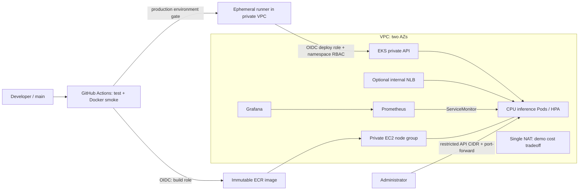

# Hugging Face → AWS EKS | DevOps portfolio

A hands-on project: a small inference API, reproducible AWS infrastructure,
CI/CD without long-lived AWS keys, and observability.
**Status:** a template for running on your own; AWS deploy and live inference are not claimed as done.
Results of the local checks that could be run are in [VALIDATION.md](docs/VALIDATION.md).

Model: [DistilBERT SST-2](https://huggingface.co/distilbert/distilbert-base-uncased-finetuned-sst-2-english),
about 67M parameters, Apache-2.0. Sentiment analysis of **English** text, POSITIVE/NEGATIVE.
This is a learning model with the limitations and biases described in its model card, not a general-purpose classifier.
The revision is pinned to a full commit SHA in `scripts/download_model.py`; safetensors are used,
`trust_remote_code=False`. Weights are baked into the image at build time; runtime is offline.



Two `t3.large` CPU nodes, two private subnets and a public subnet with NAT. The control plane is managed by AWS.
A single NAT lowers the cost of the demo environment but creates a single point of failure for egress and cross-AZ traffic.
Application: 2–4 pods, 500m CPU request, 1 CPU limit, a bounded inference queue and one worker per pod.
HPA uses the Metrics Server add-on. **HPA does not add EC2 nodes**: the node group's max_size alone
does not enable autoscaling. Overload returns 429; verify free capacity separately.

## What's inside

- `app/`, `tests/`, `Dockerfile`: JSON API, probes, Prometheus metrics, unit tests and a real-model smoke test in CI.
- `terraform/`: VPC, EKS + managed add-ons, ECR, GitHub OIDC, separate build/deploy IAM roles.
- `k8s/`: Deployment, Service, HPA, PDB, restricted namespace, a scoped deploy Role.
- `monitoring/`: Helm values, ServiceMonitor, alert rules and a Grafana dashboard.
- `.github/workflows/ci-cd.yaml`: PR checks → main build/smoke/push → gated deploy by digest.
- `examples/gpu/`: a separate opt-in GPU node group and CUDA workload.

## Prerequisites

An AWS sandbox account with billing access and quotas for EKS, EC2, Elastic IP, NAT; AWS CLI v2,
Terraform >=1.10 <2, Docker with linux/amd64 builds, Python 3.12, kubectl 1.35, Helm 3, Git, OpenSSL.
Default region is `us-west-2`; EKS version 1.35. Before apply, check that the version,
AMI/add-ons and standard support are available in your chosen region.
You need an existing IAM admin role for bootstrap (not the ARN of a temporary STS session).
Terraform is run by a human under a role allowed to create the listed resources and IAM/pass-role.
CI does **not** get Terraform/admin credentials. Sign in via AWS SSO/temporary credentials.

## 1. Test the API locally

```bash
python3.12 -m venv .venv
source .venv/bin/activate
pip install -r requirements-dev.txt
python -m pytest -q
ruff check app tests scripts/download_model.py

docker build --platform linux/amd64 -t hf-inference:local .
docker run --rm --name hf-inference --read-only --tmpfs /tmp:rw,size=128m   -p 127.0.0.1:8000:8000 hf-inference:local
# In another terminal, once it is ready:
bash scripts/smoke.sh
```

The first build downloads PyTorch and the weights; it needs internet access and a few GB of free disk.
Unit tests mock the model: the real download/inference is checked by the Docker smoke test, separately from them.
Do not run `uvicorn` on the host without a downloaded model: `/opt/model` is created during the Docker build.

```bash
curl -fsS http://127.0.0.1:8000/predict -H 'Content-Type: application/json'   -d '{"text":"This product is excellent"}'
# {"label":"POSITIVE","score":...}
```

`GET /health/live`, `GET /health/ready`, `GET /metrics/`, `POST /predict`.
Text length is 1–2000 characters; tokenization truncates input to 256 tokens.
Up to eight running/queued requests per pod, then 429. Inference runs in a separate thread
so the model queue does not block probes. Text is not written to application/access logs.
There is no authentication, TLS or rate limiting at the edge: the base Service is reachable only inside the cluster.

## 2. Create the AWS infrastructure

```bash
aws sso login --profile YOUR_PROFILE
export AWS_PROFILE=YOUR_PROFILE
aws sts get-caller-identity
cp terraform/terraform.tfvars.example terraform/terraform.tfvars
# Edit repository, admin_role_arn and your real public IP/32.
terraform -chdir=terraform init
terraform -chdir=terraform fmt -check -recursive
terraform -chdir=terraform validate
terraform -chdir=terraform plan -out=demo.tfplan
terraform -chdir=terraform apply demo.tfplan
export AWS_REGION=$(terraform -chdir=terraform output -raw region)
export CLUSTER_NAME=$(terraform -chdir=terraform output -raw cluster_name)
export ECR_URL=$(terraform -chdir=terraform output -raw ecr_url)
aws eks update-kubeconfig --region "$AWS_REGION" --name "$CLUSTER_NAME"   --role-arn YOUR_ADMIN_ROLE_ARN
kubectl get nodes
kubectl top nodes
```

`YOUR_ADMIN_ROLE_ARN` is the same role as in tfvars; the calling principal must have sts:AssumeRole.
If you are already working under that exact role, `--role-arn` can be omitted.
There is only one GitHub OIDC provider per account/URL: pass `github_oidc_provider_arn` if one already exists.
Otherwise Terraform tries to create a new provider.
Terraform state holds infrastructure data and must not end up in Git. The personal demo uses
local state; make a secure backup before cleanup. For a team, use an S3 backend:
[separate setup](docs/SECURITY.md), encryption, versioning and locking.
`.terraform.lock.hcl` is included; review lock file changes when updating dependencies.

## 3. First image push and bootstrap

```bash
aws ecr get-login-password --region "$AWS_REGION" |   docker login --username AWS --password-stdin "${ECR_URL%%/*}"
TAG="sha-bootstrap-$(date -u +%Y%m%d%H%M%S)"
docker build --platform linux/amd64 -t "$ECR_URL:$TAG" .
docker push "$ECR_URL:$TAG"
DIGEST=$(aws ecr describe-images --region "$AWS_REGION"   --repository-name "${ECR_URL#*/}" --image-ids "imageTag=$TAG"   --query 'imageDetails[0].imageDigest' --output text)
export IMAGE="$ECR_URL@$DIGEST"
bash scripts/bootstrap-app.sh
bash scripts/install-monitoring.sh
kubectl -n inference get deployment,hpa,pdb,service
kubectl -n inference port-forward service/inference 8000:80
# In another terminal:
bash scripts/smoke.sh
```

The image is deployed by digest. ECR tags are immutable; a rebuild uses a new tag.
The admin bootstrap creates the namespace, RBAC and manifests. CI updates only the image,
so apply YAML changes by re-running bootstrap with a verified IMAGE.
Re-running bootstrap temporarily resets replicas=2; HPA then continues to manage scaling.

## 4. Prometheus / Grafana

```bash
kubectl -n monitoring port-forward service/monitoring-grafana 3000:80
# Get the password in your own console (do not add it to Git/screenshots):
kubectl -n monitoring get secret grafana-admin   -o jsonpath='{.data.admin-password}' | base64 --decode
```

Open http://localhost:3000, login `admin`, dashboard **HF EKS Inference**.
Panels: RPS, P95 latency, errors, overload. Generate traffic with the smoke script and wait for the scrape/5m rate window.
Latency metrics include queueing time of accepted requests; 422 validation errors are not counted in the inference counter.
Alert rules are available in Prometheus; Alertmanager/external notifications are not configured.
Prometheus retention is 6h/2GB with ephemeral storage; Grafana is also ephemeral, the dashboard is provisioned via ConfigMap.
History is lost when monitoring pods are recreated. Production needs PVC/EBS CSI, backups,
TLS/auth, alert routing, SLOs and load testing. EKS audit logs are kept in CloudWatch for 7 days.

## 5. GitHub Actions: OIDC and deploy

Create your own empty GitHub repo and push the contents of the directory (including `.github/`).
For example, from the root of the unpacked project:

```bash
git init -b main
git add .
git commit -m "Add Hugging Face inference platform on AWS EKS"
git remote add origin https://github.com/KostanPROFF/hf-eks-portfolio.git
git push -u origin main
```

Configure the variables/environment and runner first, then run the workflow.
Until the AWS variables are set, the workflow only runs checks: build/deploy are skipped.
After configuring, use Run workflow on main.
Add the values from `terraform output` as repository Actions variables:

| Variable | Value |
|---|---|
| `AWS_REGION` | `region` |
| `CLUSTER_NAME` | `cluster_name` |
| `ECR_URL` | `ecr_url` |
| `BUILD_ROLE_ARN` | `build_role_arn` |
| `DEPLOY_ROLE_ARN` | `deploy_role_arn` |

Create a `production` Environment: required reviewers, only the protected `main` branch allowed.
Availability of required reviewers depends on your GitHub plan/visibility; set up whatever gate you can before running.
OIDC build trust is bound to the exact repo/main; deploy trust to the exact repo/environment production.
For the environment subject, the branch is controlled by **GitHub Environment deployment branch rules**, not the IAM sub.
Remove the ability to bypass reviewers where possible; protect main and workflow files with review.
No static AWS keys or HF token are needed.

The deploy job targets a **self-hosted ephemeral Linux x64 runner** with labels `self-hosted,linux,x64,eks-vpc`,
which you register separately. It is not created by Terraform: the GitHub registration credential
is intentionally kept out of state. Install AWS CLI v2, kubectl 1.35, bash and Git on the runner;
allow outbound HTTPS to GitHub, AWS STS/EKS via NAT, and VPC DNS.
Place the runner in a private subnet; allow inbound TCP/443 from its security group to the cluster primary SG.
The runner's infrastructure permissions must not include EKS/ECR admin. The job gets credentials via OIDC.
Use a single-use runner restricted to this private/trusted repo, and do not let PR jobs run on it.
For a public repo, use a dedicated runner group with workflow restrictions, or an isolated
single-use runner and strict review of main. [Network checks and operations](docs/OPERATIONS.md).

A PR runs only tests and validation on a GitHub-hosted runner, with no AWS credentials.
Push to main: tests → real-model Docker smoke → ECR push → production gate → patch Deployment → wait for rollout.
If there is no runner, the deploy job stays queued; building the image by itself does not mean a deploy.
The AWS API endpoint is restricted to the admin CIDR; the GitHub-hosted build does not connect to it.
The deploy role can only DescribeCluster and get/list/patch/watch a single Deployment; no Secrets/RBAC/admin rights.
It is a trusted CD principal: patching the Deployment allows changing the pod spec, so main/workflow review is mandatory.
CI does not publish Terraform and does not run terraform apply.

## 6. Internal LoadBalancer (optional)

First set `enable_load_balancer_controller = true` and run Terraform plan/apply:

```bash
export VPC_ID=$(terraform -chdir=terraform output -raw vpc_id)
bash scripts/install-lb-controller.sh
# IMAGE must remain the verified ECR digest from step 3.
OVERLAY=overlays/internal-nlb bash scripts/bootstrap-app.sh
kubectl -n inference get service inference -w
```

Uses AWS Load Balancer Controller 2.13.3, EKS Pod Identity and the versioned upstream IAM policy.
The NLB is internal, with IP targets and the VPC CIDR as source range. HTTP is reachable only from a network connected to the VPC/VPN;
for a public demo, use port-forward. This is not a TLS endpoint.
Do not change the class/scheme of an existing LB in place: delete the Service, wait for the AWS LB to be deleted, then recreate it.
The base ClusterIP can be replaced by this overlay; to go back from the LB, also delete the Service.
Do not remove the controller/IAM before the NLB is deleted: the finalizer is needed to release AWS resources.

## Cost and limitations

Estimate for us-west-2, USD, 730 hours/month, excluding taxes/credits/discounts; this is a demo environment budget,
not a current commercial quote. EKS standard support: $0.10/hour ≈ **$73/month**;
extended support $0.60/hour ≈ $438. Checked against [AWS EKS pricing](https://aws.amazon.com/eks/pricing/).
[Version support lifecycle](https://docs.aws.amazon.com/eks/latest/userguide/kubernetes-versions.html).

| Component | Budget estimate / month |
|---|---:|
| EKS standard control plane | $73 |
| 2 × t3.large On-Demand | $120–150 |
| Single NAT + its public IPv4, no traffic | $35–45 |
| Node disks, ECR, CloudWatch | $10–30 |
| Base environment total | **roughly $240–300** |
| Optional NLB, plus capacity/traffic | another $17–30+ |
| Optional g4dn.xlarge, 24/7 | another $380–500+ |
| Separate CI runner | extra, depends on hosting |

The EC2/NAT/storage ranges are planning assumptions, not exported price lists.
Before apply, recalculate your chosen instance type/region/GB in the [AWS Pricing Calculator](https://calculator.aws/).
Additional costs: NAT processing, egress, cross-AZ data, ECR transfer/storage, public IPv4, T3 surplus credits,
CloudWatch ingestion and the runner. At low traffic, burstable T3 is fine for a demo;
for sustained CPU inference, compare M/C instances. Set up an AWS Budget alert in advance.
Do not promise SLAs/latency or savings without measurements. Terraform destroy removes the environment; stopping pods does not stop EKS/NAT billing.

## Cleanup — order matters

Stop/disable the workflow and runner, and save any evidence you need for your portfolio.
First delete Kubernetes resources with AWS finalizers while the cluster/controller/IAM still work:

```bash
kubectl -n inference delete service inference --ignore-not-found
# If you had an NLB: wait until it is deleted in AWS EC2 Load Balancers along with its target groups/ENIs.
kubectl delete namespace inference --ignore-not-found
helm uninstall monitoring -n monitoring
kubectl delete namespace monitoring --ignore-not-found
# If installed:
helm uninstall aws-load-balancer-controller -n kube-system
# If you had the GPU plugin:
helm uninstall nvdp -n gpu-system
kubectl delete namespace gpu-system --ignore-not-found
```

Skip `helm uninstall` for releases that were not installed. Deleting the monitoring namespace removes
its secrets/data; Helm CRDs may remain until EKS is deleted, which is fine for a disposable cluster.
ECR is protected by `force_delete=false`: first deliberately empty **only this environment's repository**,
after stopping CI. The commands below irreversibly delete its images:

```bash
export ECR_REPOSITORY="${ECR_URL#*/}"
aws ecr list-images --region "$AWS_REGION" --repository-name "$ECR_REPOSITORY"   --query 'imageIds' --output json > /tmp/hf-eks-image-ids.json
# For a small demo repo (<100 image IDs); with more, delete in batches of <=100.
# If the JSON is empty [], skip batch-delete.
aws ecr batch-delete-image --region "$AWS_REGION" --repository-name "$ECR_REPOSITORY"   --image-ids file:///tmp/hf-eks-image-ids.json
terraform -chdir=terraform plan -destroy -out=cleanup.tfplan
terraform -chdir=terraform apply cleanup.tfplan
```

Check EC2 instances, NAT Gateway/EIP, NLB/target groups, ECR, CloudWatch log groups and volumes by the Project tag.
Remove the separately created runner and its registration, and, if needed, external backend buckets/state backups,
only after a successful destroy. An existing GitHub OIDC provider passed by ARN is not deleted by this project.
If a controller finalizer hangs, restore the controller/IAM and check the logs; do not remove the finalizer blindly.

## How to present it in a portfolio

Add your own screenshots of a successful GitHub Actions run, `kubectl get pods/hpa`, Grafana and a JSON prediction.
Record the date, region, image digest, number of requests and measured latency/RPS. Results are not included
automatically: this repository does not prove that an AWS deploy was performed.

After a real run, you can use this wording in a résumé:
"Deployed a Hugging Face CPU inference API on AWS EKS; defined VPC/EKS/ECR in Terraform,
set up GitHub Actions with OIDC and separated IAM/RBAC, HPA and Prometheus/Grafana monitoring."
Quote real metrics and costs; do not claim production experience/SLAs without grounds.

## Sources and updates

- [EKS access entries](https://docs.aws.amazon.com/eks/latest/userguide/access-entries.html)
- [EKS network load balancing](https://docs.aws.amazon.com/eks/latest/userguide/network-load-balancing.html)
- [EKS module 21.26.0](https://registry.terraform.io/modules/terraform-aws-modules/eks/aws/21.26.0)
- [GitHub OIDC on AWS](https://docs.github.com/en/actions/security-for-github-actions/security-hardening-your-deployments/configuring-openid-connect-in-amazon-web-services)
- [EKS Pod Identity](https://docs.aws.amazon.com/eks/latest/userguide/pod-identities.html)

Modules/charts/model revision are pinned. Actions are pinned by commit SHA; Dependabot is configured for updates. Docker base tags need regular updates;
for a strict supply chain, pin verified base image digests and add SBOM/signing and a vulnerability gate.
ECR scan-on-push is enabled, but by itself it does not block deploying a vulnerable image.
Project code is MIT; the model and third-party components keep their own licenses.
